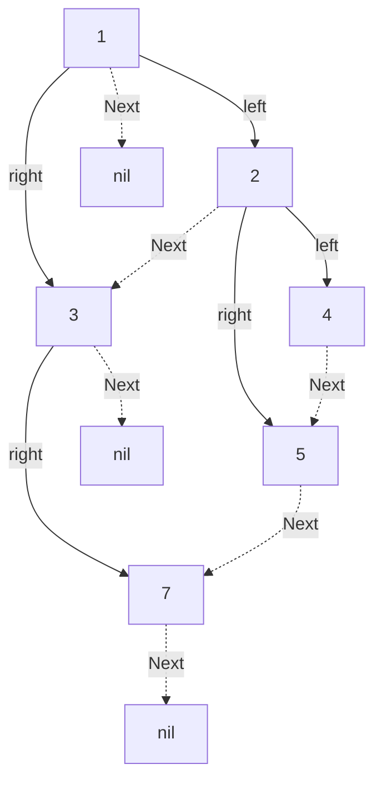

# 117. Populating Next Right Pointers in Each Node II

**Difficulty:** Medium

Populate each node's `Next` pointer with the next node to its right on the same level. Set `Next` to `nil` when no such node exists. Initially, all `Next` pointers are `nil`.

**LeetCode Go API:** `func connect(root *Node) *Node`

## Examples

- `[1,2,3,4,5,null,7]` → `[1,#,2,3,#,4,5,7,#]`
- `[]` → `[]`

## Constraints

- The number of nodes in the tree is in the range `[0, 6000]`.
- `-100 <= Node.val <= 100`

## Recursive approach using `Next`

When `connect(node)` runs, assume `node.Next` already points to the next node on its level. Use that chain to find the next available child for `node`'s children:

```text
connect(node):
    if node is nil:
        return

    if node.right exists:
        node.right.next = firstChild(node.next)

    if node.left exists:
        if node.right exists:
            node.left.next = node.right
        else:
            node.left.next = firstChild(node.next)

    connect(node.right)  // process right before left
    connect(node.left)

firstChild(start):
    while start exists:
        if start.left exists:  return start.left
        if start.right exists: return start.right
        start = start.next
    return nil
```

`firstChild` scans the remaining parents on the current level and returns the first child it finds, checking left before right. Processing the right subtree first ensures its links are ready when the left subtree needs to scan across it.

For `[1,2,3,4,5,null,7]`, node 1 links `2 → 3`; node 3 links `7 → nil`. At node 2, `4 → 5`, and `firstChild(node2.next)` starts at node 3, skips its missing left child, and finds 7, giving `5 → 7`.



This avoids a queue or other auxiliary collection. Recursion still uses `O(h)` call-stack space, where `h` is the tree height; strict `O(1)` total extra space requires an iterative traversal.
